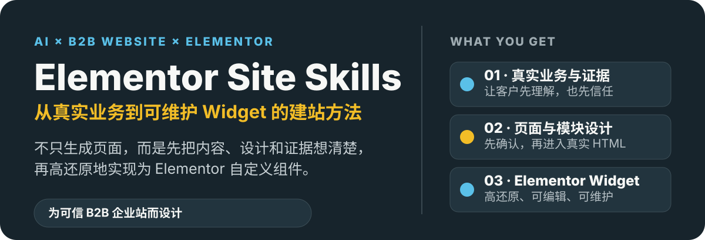
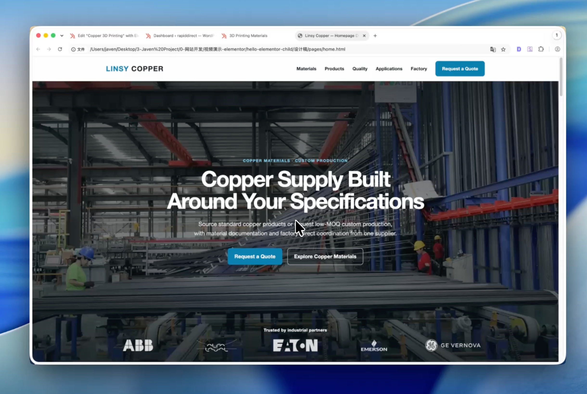
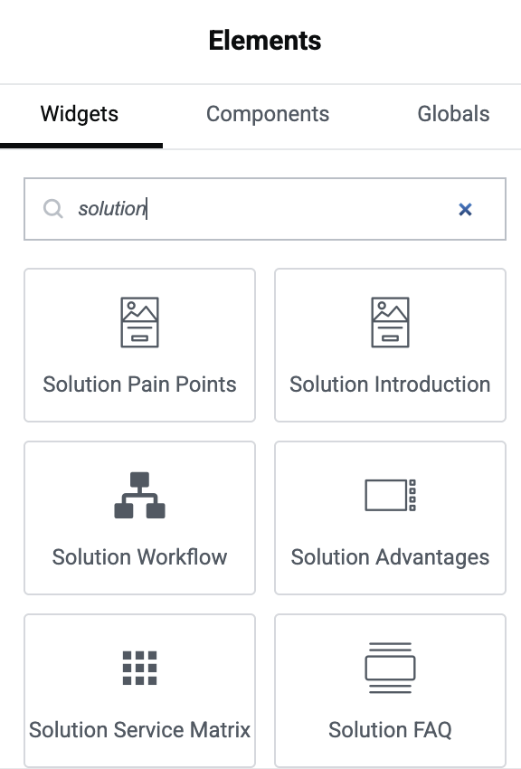
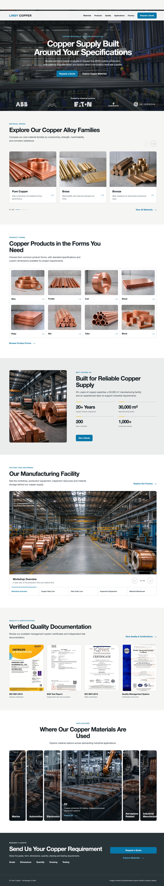
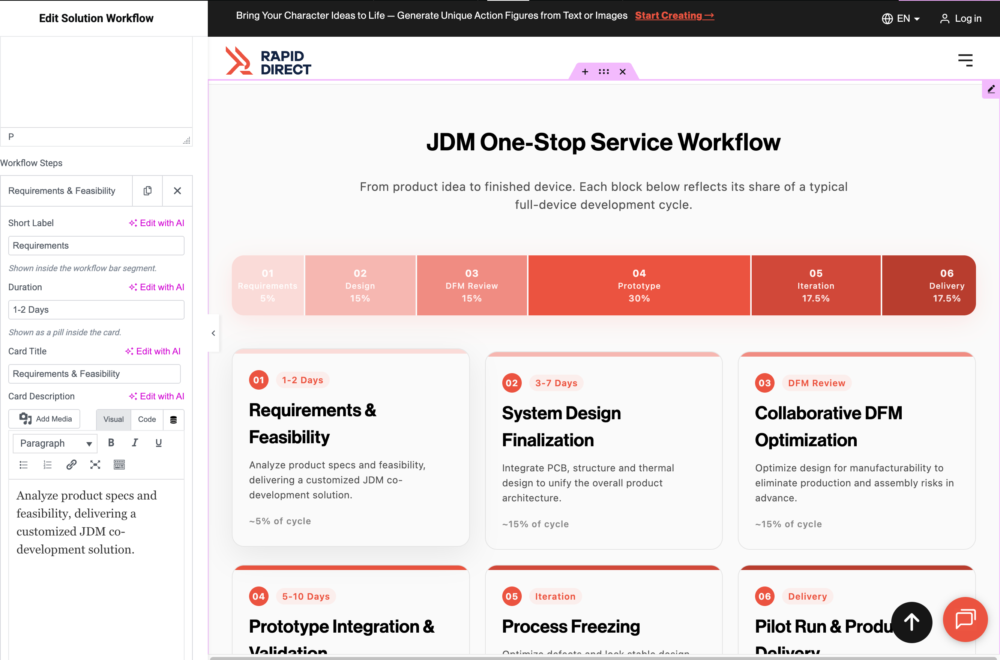
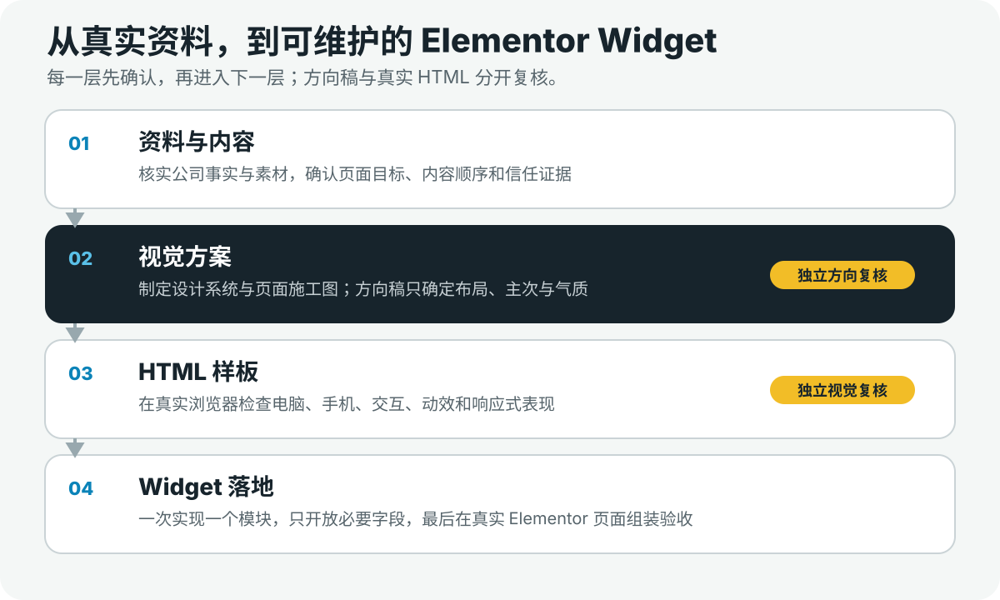

<p align="right"><strong>简体中文</strong> · <a href="./README_EN.md">English</a></p>

<p align="center">
  
</p>

# 🧩 Elementor Site Skills

> 一套面向真实企业对企业（B2B）项目的分层建站工作流：先核实公司资料、规划页面、视觉风格与必要的克制动效，再完成浏览器验证和可维护的 Elementor 自定义组件。

这不是“输入一句话直接生成网站”的模板包，而是 **1 个总控 + 8 个专项 AI 工作角色（Skills）**。它会根据项目现状选择当前真正需要的阶段，并把业务判断、视觉确认、独立复核和工程验证放在各自正确的位置。

## 🖼️ 先看看它最终能做成什么

下面这个 B2B 首页不是从模板直接套出来的。它先核实业务与素材，再规划页面内容、统一视觉规则、确认页面效果，最后才进入浏览器和 Elementor 实现。

<p align="center">
  <a href="https://github.com/javen-wangjunren/elementor-website-skill/releases/download/v0.1.0/homepage-demo.mp4">
    
  </a>
</p>

<p align="center"><strong>点击图片下载约 20 秒完整页面录屏</strong></p>

它的终点也不只是设计稿或可浏览网页（HTML）。确认后的模块会沉淀为 Elementor 自定义组件（Widget）：可以在组件面板中搜索和插入，也只开放真正需要编辑的字段。

<p align="center">
  <a href="./assets/readme/Elementor-widget.png">
    
  </a>
</p>

<details>
<summary><strong>查看完整长页面与 Widget 编辑效果</strong></summary>

<br />



<br />



</details>

## 🎯 这套 Skills 适合谁

这套 Skills 面向所有对外贸建站感兴趣、希望自己动手做企业官网的人，尤其适合外贸销售、外贸 SOHO、外贸运营、小型外贸团队，以及第一次系统做网站的零基础使用者。

你可能已经知道可以用 **WordPress + Elementor** 建站，却还不清楚在 AI 时代应该怎样把公司资料、页面内容、视觉设计和网站开发真正串联起来。你想做的也不只是一个“能打开的网站”，而是一个运行稳定、视觉得体，并且能让海外客户看懂业务、建立信任、愿意提交询盘的 B2B 企业官网。

这套 Skills 想解决的，正是从“我想自己做网站”到“我知道每一步应该做什么”的问题。它会带你逐步了解：

- 建站前应该准备哪些真实资料；
- 一个合格的 B2B 网站应该讲清楚什么；
- 页面内容怎样帮助客户理解你、信任你；
- 怎样规划网站视觉和模块，而不是简单套用模板；
- 怎样把确认后的设计做成稳定、可维护的 Elementor 自定义组件；
- 网站完成后应该检查什么，才能真正投入使用。

它也适合那些不想完全依赖第三方建站公司、希望掌握网站主动权的人。你不需要一开始就懂设计或开发；这套流程会揭开建站的“神秘面纱”，让你看清一个网站从资料、内容和设计，到开发、检查和上线的完整过程。

## ✨ 它会帮你把什么真正做出来

很多朋友在用 AI 建站时，遇到的并不是“AI 不会写代码”，而是不知道网站应该讲什么、页面怎样安排、设计好不好，以及最后怎样放进 WordPress 里长期使用。

这套 Skills 会帮你把这些零散问题连成一条完整路径：

- **把公司资料变成清晰的网站内容**：整理产品、服务、优势和证据，明确每个页面应该解决客户的什么问题；
- **让页面更有说服力**：不只是堆放产品图片和公司介绍，而是帮助海外客户看懂你能做什么、为什么值得信任，以及下一步怎样联系你；
- **建立统一的网站视觉**：提前确定颜色、字体、间距和整体风格，避免不同页面像从不同模板里拼出来；
- **把页面想法变成可以真实浏览的效果**：先在电脑和手机上检查完整页面，再决定是否进入 WordPress 开发；
- **把确认后的模块做成 Elementor Widget**：需要修改的内容可以在后台编辑，不需要把大段 HTML 直接塞进 Elementor；
- **让网站更容易维护和继续扩展**：以后增加页面或模块时，可以沿用已经确认的内容、视觉和组件规则。

它不是替你“一键生成一个网站”，而是让你逐渐掌握：**一个合格的外贸网站应该怎样规划、怎样设计、怎样实现，又应该怎样检查。**

## 🏢 为什么从 B2B 出发

B2B 网站面对更复杂的业务信息和更长的决策链路。“设计好”不仅是好看，还要让客户看懂你做什么、相信你能做到，并愿意询价。因此，页面顺序、模块任务、真实证据和视觉重量都必须服务于客户决策。

最终示例使用 **WordPress + Elementor**，但页面规划、视觉规范、设计审查和按原因返工的方法，同样可以迁移到 Gutenberg、ACF、Next.js、Astro、React 或其他 CMS。原则始终是：**先把判断做对，再选择实现方式。**

这套仓库的最终开发路径仍然是 Elementor 自定义 Widget，更适合以企业展示、获客和常规内容维护为主的网站。如果项目包含多个 CPT（自定义内容类型，也就是把产品、材料、工艺、行业等分别做成独立内容库），并且存在复杂关联、查询和模板逻辑，就不建议为了继续使用 Elementor 而硬套这条实现路径。前期内容与设计方法仍然可以沿用，开发阶段更适合转向 ACF、自定义主题或其他完整的 WordPress 工程方案。

AI 可以快速生成完整页面，也可能把未经确认的判断一路带进代码。这套分层流程的目的，就是在事实、内容、视觉系统、页面设计和实现之间建立清晰权威，让高成本错误更早暴露、更小范围修正。

## 👋 Hi，我是 Javen

我目前在 CNC 公司 RapidDirect 负责网站运营，并长期参与网站页面的策划与建设。目前来自 Google 搜索的月流量超过 10 万，网站权威度指标 DR 约为 70。我在年初开始接触 AI 建站，目前摸索出一套从页面设计到 Elementor 组件落地的方法。

我把自己在真实 B2B 企业站项目中反复使用的做法整理成了这组 Skills。它会陪你从公司资料、页面规划和视觉风格，一路走到可浏览页面与 Elementor 组件，把确认后的设计沉淀为可复用、可维护的网站资产。

我希望这些经验能帮你更高效地使用 AI 做网站，少踩一些设计还原、组件复用和后期维护上的坑。如果你在使用过程中有任何想法、问题或改进建议，也欢迎告诉我；我会认真阅读，并持续把这套 Skills 打磨得更好。

> 我的原则很简单：让 AI 多做产出和自检；真正影响业务与设计方向的决定，始终留给你确认。

## 🗺️ 跟着它怎么走

<p align="center">
  
</p>

可以把整套流程想成盖房子：先查清地基和需求，再画图、看效果、做样板，最后才正式施工。总控不会要求所有任务都从第一步开始；它会根据已有成果，从当前真正需要的位置继续。

```text
核实公司资料与真实素材
→ 必要时考察 3–5 个参考网站
→ 写清页面大纲：讲什么、先讲什么、拿什么证明
→ 定好全站装修规范：颜色、字体、间距、视觉气质与基础运动性格
→ 画页面施工图，确认每个模块的位置、任务和必要的动效意图
→ 查看页面效果图；使用方向稿时先做一次独立方向复核
→ 制作可以真实浏览的 HTML 样板间
→ 检查电脑、手机和交互，并完成独立视觉复核
→ 一次施工一个 Elementor 组件
→ 在真实 Elementor 页面中组装并验收
```

## ⚡ 5 分钟 Quick Start

这不是一个下载后即可安装的通用组件包，而是一支为**当前网站项目**服务的 AI 建站队伍。你先在本地完成页面内容、Elementor 模块设计与开发，再把生成的自定义 Widget 插件上传到 WordPress 网站使用。

### 使用前准备

- 一个能够读取本地 Skills 和项目文件的 AI Coding 工具，例如 TRAE、WorkBuddy 或 Codex；
- 一份公司资料目录，至少包含公司介绍、产品或服务、目标市场和客户；
- 一个本地项目文件夹，例如 `my-b2b-site/`；
- 准备验证 Widget 时，确保目标 WordPress 网站已经安装 Elementor。

### 开始使用

1. 下载或克隆本仓库，将根目录下的 9 个 Skill 文件夹复制到 `~/.agents/skills/elementor/`。
2. 打开本地项目工作区，调用 `elementor-site-team-manager`。
3. 先让总控检查现有资料、已确认成果和当前进度，不要一上来就生成页面。
4. 第一次进入组件开发时，`elementor-site-initialize` 会在你确认的路径创建插件骨架。
5. Widget 完成后，将**完整插件目录**复制到 WordPress 网站的 `wp-content/plugins/`；也可以只压缩该插件目录，在后台通过“插件 → 安装插件 → 上传插件”安装。

直接复制下面这段即可开始：

```text
使用 elementor-site-team-manager，帮助我从当前项目状态开始完成一个 B2B 企业站。

公司资料位于：<path>
计划页面：<pages>
项目工作区：<local-project-path>
目标：完成页面设计，并将确认模块实现为可维护的 Elementor 自定义 Widget 插件。

请先检查当前项目状态，不要立即生成页面；不要重做已经确认的内容。请告诉我目前处于哪个阶段、还缺什么，以及最推荐的下一步。
```

### 安装成功的判断

第一次调用后，只要总控能够做到下面三点，就说明 Skills 已经可以正常工作：

- 先读取项目目录、配置和已有文档，而不是直接生成页面；
- 说清楚当前处于资料、内容、设计、HTML 还是 Widget 阶段；
- 列出缺失材料和下一步建议，并在需要你决定时停下来确认。

> 只压缩生成的插件目录，不要把整个项目工作区、设计稿或 `docs/` 一起上传。后续增加 Widget 时，也应以本地插件目录为准：更新插件版本、完整压缩、先备份或在测试站验证，再替换旧版本。

## 🧭 这支 AI 建站队伍如何分工

你不需要先记住下面这些名称。把它们看成一支施工队即可：总控负责判断进度，专项 Skill 各自完成一类工作。

| Skill                             | 像什么角色   | 用通俗的话说                               |
| --------------------------------- | ------- | ------------------------------------ |
| `elementor-site-team-manager`     | 总包项目经理  | 看清当前进度，把任务交给正确的专项 Skill              |
| `elementor-site-initialize`       | 工地管理员   | 建好项目目录和插件骨架                          |
| `website-reference-researcher`    | 案例考察员   | 研究值得借鉴的网站，学方法但不照搬                    |
| `website-page-content-architect`  | 页面策划    | 写清页面给谁看、讲什么、按什么顺序讲                   |
| `website-design-system-architect` | 装修规范设计师 | 定好全站共用的颜色、字体、间距、视觉气质与基础运动性格          |
| `elementor-site-style-adapter`    | 规范翻译员   | 把视觉规范转成 Elementor 可继承的全站样式说明         |
| `website-ui-architect`            | 页面设计师   | 画页面施工图和效果图，安排模块如何表达，并在进入 HTML 前复核方向稿 |
| `website-html-prototyper`         | 样板间施工队  | 把确认设计与动效做成可浏览的 HTML，并完成浏览器检查和独立视觉复核  |
| `elementor-widget-pipeline`       | 组件施工队   | 把确认模块做成可编辑、可维护的 Elementor 组件         |

> 总控还会在资料不足时先做一次轻量的“公司资料核验”（Company Intake）。参考研究也只在确有需要时启动，不会让每个页面都走一遍完整流程。

## ✅ 我们会怎样检查方向稿和 HTML 设计稿

页面不会从方向稿一路照搬到 Widget。我们会在两个关键阶段分别检查，尽量在进入 Elementor 开发前发现问题。

### 方向稿：先确认设计方向有没有走偏

- 页面结构和模块顺序是否符合页面目标；
- 内容重点、信任证据和行动入口是否清楚；
- 整体风格是否符合企业定位和已经确认的视觉规范；
- 有没有明显的模板感、信息重复或不适合继续照搬的设计。

方向稿不等于设计稿，它只负责确认布局、主次和整体气质。精确的换行、间距、图片裁切和交互细节，会留到 HTML 阶段继续打磨。

### HTML 设计稿：再精细调整每个模块的设计和交互

- 电脑和手机上的排版、间距和图片是否正常；
- 字体、颜色和模块风格是否保持统一；
- Tabs、Accordion、轮播等交互是否可以正常使用；
- 动效是否自然，是否真的帮助理解而不是干扰阅读；
- 最终页面是否符合已经确认的内容和设计方向。

检查方向稿和 HTML 设计稿时，总控会按需要调用一个没有参与前面制作的**子 Agent**。你可以把它理解为一位独立的 AI 审查员：它会用新的视角检查页面，指出问题、说明原因并给出修改建议，但不会直接替你决定设计方向。

发现问题后，我们会先确认问题是否真实，再回到对应环节修正；严重问题解决前，不会直接进入 Widget。已经说清楚的局部修改则直接处理，不会为了检查而重新走一遍完整流程。

如果你只是觉得某个模块“怪怪的”，却说不清原因，也可以主动要求子 Agent 辅助诊断。它负责帮助找问题和比较方案，最终设计仍然由你确认。

## 🛣️ 你可以先做完整页面，也可以只做一个模块

进入 HTML 设计阶段时，不一定每次都要从完整页面开始。你可以根据当前任务，选择下面两种方式。

### 做一个全新页面：先生成整页 HTML 设计稿

方向稿确认后，先把整个页面实现成可以真实浏览的 HTML 设计稿。这样可以先检查页面结构、模块顺序和整体视觉节奏，再逐个精细调整里面的模块。

这种方式适合制作首页、产品页、服务页等完整的新页面。

### 只做某个模块：直接生成单模块 HTML 设计稿

如果你只想新增或重新设计某一个模块，可以从该模块的方向稿直接进入 HTML 实现，不需要先把整页重新制作一遍。模块确认并打磨完成后，再把它放回现有页面，或者继续制作成 Elementor Widget。

这种方式适合新增 Banner、流程、优势、FAQ、案例展示等独立模块。

两种方式没有高低之分：做新页面时优先看整页，只改局部时专注单个模块。进入 Widget 开发前，只需要确认最终以哪一版 HTML 设计稿为准。

<details>
<summary><strong>✅ 查看每一步需要你确认什么</strong></summary>

<br />

| 走到哪里            | 需要你确认什么                            |
| --------------- | ---------------------------------- |
| 核实公司资料          | 公司做什么、服务谁、哪些主张和素材可以公开使用            |
| 研究参考网站          | 看哪些网站；只学规律，不复制品牌和内容                |
| 规划页面大纲          | 页面目标、内容顺序、真实文案和所需素材                |
| 制定全站装修规范        | 颜色、字体、间距、整体视觉气质与基础运动性格             |
| 绘制页面施工图         | 每个模块放在哪里、承担什么任务，以及是否真的需要动效         |
| 查看页面效果图         | 构图、内容主次、密度和整体节奏；方向稿问题是否已经独立复核      |
| 检查浏览器样板间        | 电脑和手机上的真实页面是否符合预期，独立检查发现的严重问题是否已解决 |
| 制作 Elementor 组件 | 哪些内容需要在后台编辑，以及最终以哪版设计为准            |

</details>

## 💡 使用 Tips

- **不知道该调用谁时，只找总控**：直接调用 `elementor-site-team-manager`，让它判断下一步，不必记住全部 Skill 名称。
- **告诉它哪些已经确认**：例如“页面大纲已确认，不要重写”“这张图只是布局参考”，能减少重复劳动和误解。
- **先做代表性页面**：新站优先完成首页或一个最关键页面，确认内容、视觉和实现方式成立后再铺开。
- **说清图片的用途**：区分灵感参考、方向稿和需要精准还原的设计稿；方向稿只定布局和气质，不应被机械照搬。
- **感觉不对但说不清时再请独立复核**：你有明确修改方向时直接改；只有“怪怪的”却找不到原因时，再让独立 AI 角色辅助诊断。
- **一次实现一个 Widget**：先在 HTML 中确认设计和交互，再进入 Elementor，排查问题会更容易。
- **以本地插件目录为唯一准稿**：不要直接在服务器插件目录里长期修改；每次更新版本后完整打包，并先备份或在测试站验证。
- **最后一定回到真实 Elementor 验收**：检查电脑、手机、编辑器重载、多个实例、字体、图片裁切和交互状态。

如果当前 AI 工具不支持创建独立 AI 角色，可以按同一标准完成自查，但应明确标记“未完成独立复核”，不要把自查当成独立评审。

## 📁 过程中会沉淀下来的文件

这些文件相当于项目的资料册、施工图和验收记录，主要由总控维护。初次使用时不用逐个理解，只需知道重要决定会被保存，后续可以接着做，而不是每次从头开始。

```text
docs/
├── company/about-company.md
├── research/<scope>-visual-reference-brief.md
├── page-content/<page-slug>.md
├── design-system/design-system.md
├── elementor/elementor-style-contract.md
└── workflow-status.md

elementor-project.json

设计稿/
├── design-system/style-board.html
├── directions/<page-slug>/
├── pages/<page-slug>.html
├── modules/<module-slug>.html
└── reviews/<page-slug>/           # 只有加强评审实际触发时才创建

<用户确认的插件路径>/
└── <plugin-slug>/                 # 最终复制或压缩后上传到 WordPress
```

Elementor 插件可以把所有组件放在同一层（`Flat`），也可以按业务分类管理（`Grouped`）。`elementor-site-initialize` 会根据组件数量提出建议；确认后，后续实现不会擅自改变结构。

## 🚧 适用范围与局限

这套 Skills 专注于**页面设计和 Elementor 自定义 Widget 开发**。使用前提是：你已经有一个可以正常访问的 WordPress 网站，并且准备使用 Elementor 搭建或改版页面。

**适合使用：**产品或服务内容结构比较简单，主要通过普通Page页面维护，或者只有一个相对简单的产品 / 服务内容体系，没有多个相互关联的自定义内容库。

**建议换开发方式：**网站同时包含 Material、Service、Industry、Case Study、Surface Finish 等多个 CPT（自定义内容类型），并且需要处理它们之间的关联、筛选、查询和不同模板。这时更适合使用 **ACF + 自定义主题开发**：通过 ACF 管理每类内容的字段和关联，再由主题代码负责数据查询、筛选以及不同页面模板，而不是把这些复杂逻辑全部放进 Elementor Widget。

即使最终不使用 Elementor，本套SKILL涉及到的前期的内容规划、视觉规范和页面设计方法仍然可以继续使用。

## 📚 如果你想再多了解一点

如果你想进一步了解这套方法从哪里来，以及它和“一句话生成网站”有什么区别，可以继续阅读这些复盘：

- [AI + WordPress 网站生产体系与一句话生成的区别](./复盘反思/AI-WordPress网站生产体系与一句话生成的区别.md)
- [分层设计系统](./复盘反思/layered-design-system.md)
- [完整使用说明与设计复盘](./复盘反思/Elementor自定义组件建站Skills使用说明与设计复盘.md)
- [B2B 网站模块设计判断框架](./复盘反思/B2B网站模块设计判断框架.md)
- [从隐性经验到可用 Skill 的复盘](./复盘反思/从隐性经验到可用Skill的复盘.md)
