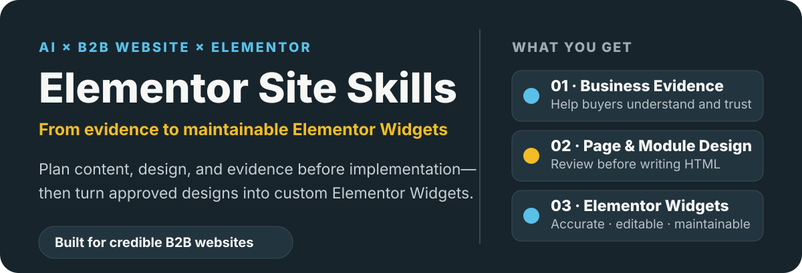
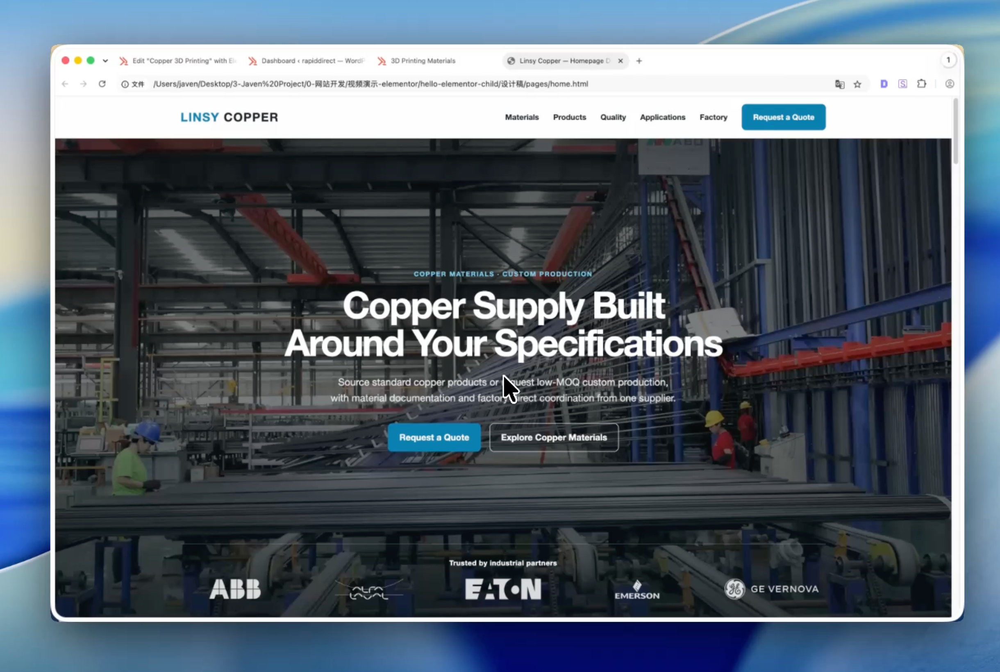
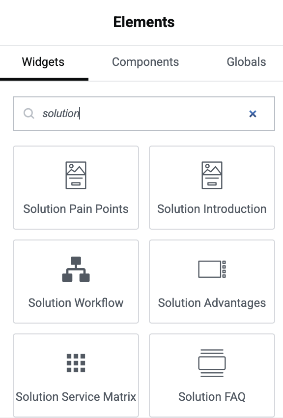
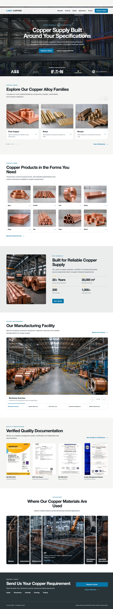
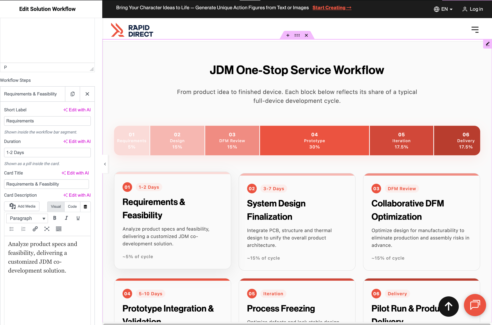
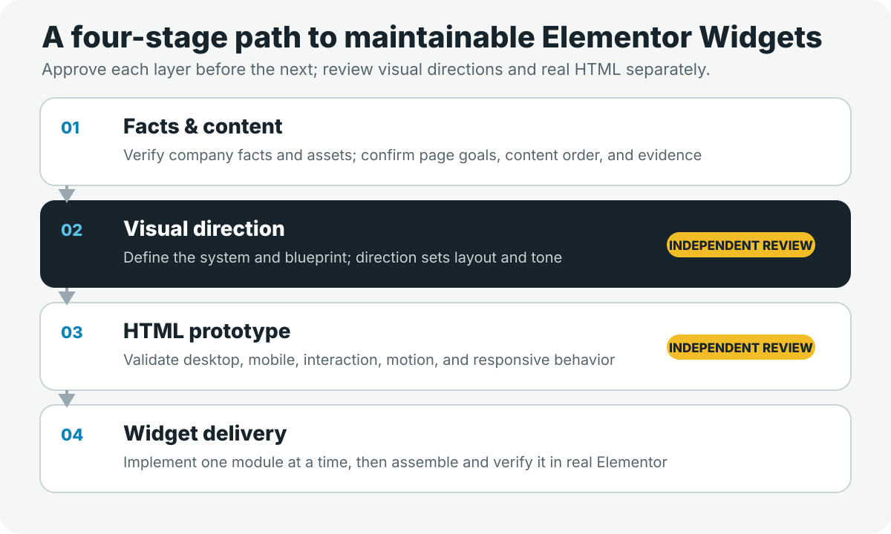

<p align="right"><a href="./README.md">简体中文</a> · <strong>English</strong></p>

<p align="center">
  
</p>

# 🧩 Elementor Site Skills

> A layered, AI-assisted workflow for real B2B website projects: verify company facts, plan the page and visual system, prototype in the browser, and turn approved modules into maintainable custom Elementor Widgets.

This is not a “one prompt, one finished website” template pack. It is a team of **one coordinator and eight specialist Skills**. Together, they route each project to the stage it actually needs and keep business decisions, design approval, independent review, implementation, and QA in the right places.

## 🖼️ See the outcome first

The B2B homepage below was not assembled from a generic template. The workflow verified the business and source materials, planned the content, established a visual system, reviewed the page direction, and only then moved into browser and Elementor implementation.

<p align="center">
  <a href="https://github.com/javen-wangjunren/elementor-website-skill/releases/download/v0.1.0/homepage-demo.mp4">
    
  </a>
</p>

<p align="center"><strong>Click the image to download the 20-second page walkthrough</strong></p>

The result is not just a mockup or browser-ready HTML. Approved modules become custom Elementor Widgets that can be searched and inserted from the Elementor panel, while exposing only the fields editors genuinely need.

<p align="center">
  <a href="./assets/readme/Elementor-widget.png">
    
  </a>
</p>

<details>
<summary><strong>View the full page and Widget editing experience</strong></summary>

<br>



<br><br>



</details>

## 🎯 Who this is for

These Skills are for anyone interested in building an export-focused company website, especially international sales professionals, export SOHOs, website operators, small export teams, and first-time builders with little or no design or development experience.

You may already know that **WordPress + Elementor** can be used to build a website, but not how to connect company materials, persuasive page content, visual design, and implementation in the AI era. The goal is not merely a website that opens. It is a stable, presentable B2B website that helps overseas buyers understand your business, trust your company, and feel ready to send an enquiry.

The workflow shows you what to prepare, what a qualified B2B page should communicate, how to plan its visual system and modules, how to turn approved designs into maintainable Elementor Widgets, and what to check before the site is ready for real use.

It is also for people who do not want to depend entirely on a third-party website agency. You do not need to begin as a designer or developer; the workflow makes the website-building process visible and understandable from content and design through implementation and validation.

## ✨ What it helps you build

The common problem with AI website building is not that AI cannot write code. It is that people often do not know what the site should say, how the page should be structured, whether the design is working, or how the result should live inside WordPress.

These Skills connect those decisions into one practical path:

- **Turn company materials into clear website content:** organize products, services, advantages, and evidence around the questions each page must answer.
- **Make pages more persuasive:** help overseas buyers understand what you do, why they should trust you, and how to take the next step.
- **Create one consistent visual system:** define color, typography, spacing, and visual tone before pages turn into a mixture of unrelated templates.
- **Turn ideas into a real browser experience:** validate the complete page on desktop and mobile before moving into WordPress development.
- **Turn approved modules into Elementor Widgets:** expose the content editors need without pasting large blocks of raw HTML into Elementor.
- **Keep the site maintainable and expandable:** reuse approved content, visual rules, and components when new pages or modules are added.

The goal is not to generate a website in one click. It is to help you understand how a qualified export website should be planned, designed, implemented, and checked.

## 🏢 Why the workflow starts with B2B

B2B websites carry complex business information and support longer buying journeys. “Good design” is therefore not just visual novelty. Buyers need to understand what you do, believe that you can deliver it, and feel confident enough to enquire. Page order, module purpose, evidence, and visual emphasis all need to support that decision.

The final implementation in this repository uses **WordPress + custom Elementor Widgets**, but the methods for page planning, visual systems, design review, and root-cause rework can also be applied to Gutenberg, ACF, Next.js, Astro, React, or another CMS. The principle remains the same: **make the decisions well before choosing the implementation.**

The implementation path in this repository is still designed around custom Elementor Widgets. It works best for company websites focused on presentation, lead generation, and ordinary content maintenance. If a project relies on several CPTs (custom post types—separate content collections for products, materials, processes, industries, and similar objects) with complex relationships, queries, and templates, forcing everything through Elementor is usually the wrong trade-off. The content and design stages remain reusable, while implementation is better handled through ACF, a custom theme, or another full WordPress development workflow.

AI can generate a complete-looking page quickly, but it can also carry unverified assumptions all the way into code. This layered workflow establishes clear sources of truth across facts, content, visual systems, page design, and implementation so expensive mistakes appear earlier and can be corrected within a smaller scope.

## 👋 Hi, I’m Javen

I manage website operations at RapidDirect, a CNC manufacturing company, and I am closely involved in page planning and production. The site currently receives more than 100,000 monthly organic clicks from Google Search and has a Domain Rating of around 70. I started exploring AI-assisted website building earlier this year and have since developed a practical workflow from page design to Elementor Widget implementation.

These Skills capture methods I have repeatedly used in real B2B website projects. They move from company facts, page planning, and visual direction to browser-ready pages and Elementor Widgets, turning approved designs into reusable, maintainable website assets.

I hope this repository helps you work with AI more effectively and avoid common problems in design fidelity, component reuse, and long-term maintenance. Suggestions, questions, and improvements are always welcome—I read them carefully and will keep refining the workflow.

> My principle is simple: let AI do more production and self-checking, while keeping the business and design decisions that matter in human hands.

## 🗺️ How the workflow moves

<p align="center">
  
</p>

Think of the workflow like constructing a building: inspect the foundation, prepare the plans, approve the direction, build a prototype, and only then begin production. The coordinator does not force every task to start at step one; it continues from the earliest stage the current project actually needs.

```text
Verify company facts and real assets
→ Research 3–5 reference websites when needed
→ Plan what the page says, in what order, and with what evidence
→ Establish site-wide color, typography, spacing, visual tone, and motion principles
→ Map every module, its commercial job, and any justified motion intent
→ Review the visual direction; when images are used, run an independent direction critique
→ Build a browser-ready HTML prototype
→ Check desktop, mobile, and interaction behavior, then run an independent visual review
→ Implement one Elementor Widget at a time
→ Assemble and verify the page in a real Elementor environment
```

## ⚡ 5-minute Quick Start

This is not a universal Widget plugin that you install immediately after downloading. It is an AI website team for **your current website project**: complete the page content, Elementor module design, and development locally, then hand the generated custom Widget plugin to WordPress.

### Before you start

- An AI coding workspace that can read local Skills and project files, such as TRAE, WorkBuddy, or Codex.
- A company-materials folder containing at least a company profile, products or services, target markets, and customers.
- A local project workspace such as `my-b2b-site/`.
- WordPress and Elementor when you are ready to validate the Widgets.

### Start the workflow

1. Download or clone this repository, then copy the nine Skill folders at the repository root into `~/.agents/skills/elementor/`.
2. Open your local project workspace and invoke `elementor-site-team-manager`.
3. Ask the coordinator to inspect existing materials, approved work, and current progress before generating anything.
4. When Widget development begins, `elementor-site-initialize` creates the plugin skeleton at a path you approve.
5. After local verification, copy the **complete plugin folder** into WordPress `wp-content/plugins/`, or compress only that folder and upload it through **Plugins → Add New Plugin → Upload Plugin**.

Copy this prompt to begin:

```text
Use elementor-site-team-manager to help me complete a B2B website from the current project state.

Company materials: <path>
Planned pages: <pages>
Local project workspace: <local-project-path>
Goal: complete the page design and turn approved modules into a maintainable custom Elementor Widget plugin.

Inspect the current project state before generating a page. Do not redo approved work. Tell me which stage the project is in, what is missing, and the recommended next step.
```

### How to know the installation worked

The Skills are working when the coordinator can do all three of the following on the first run:

- Read the project folders, configuration, and existing documents before generating a page.
- Identify whether the project is currently in research, content, design, HTML, or Widget implementation.
- List missing inputs and recommend the next step, pausing when a decision needs your approval.

> Compress only the generated plugin folder—not the full workspace, design files, or `docs/`. For later Widget updates, keep the local plugin folder as the source of truth: update the plugin version, compress the complete folder, back up or test on staging, and then replace the previous version.

## 🧭 How the AI website team is divided

You do not need to memorize these names. Think of them as a project team: the coordinator evaluates progress, while each specialist Skill owns one class of work.

| Skill | Role | In plain English |
| --- | --- | --- |
| `elementor-site-team-manager` | Project coordinator | Reads the project state and routes the next task to the right specialist |
| `elementor-site-initialize` | Workspace manager | Creates the project structure and plugin skeleton |
| `website-reference-researcher` | Reference researcher | Studies useful websites for patterns without copying their brand or content |
| `website-page-content-architect` | Page strategist | Defines the audience, message, evidence, and content order |
| `website-design-system-architect` | Design-system architect | Establishes shared color, typography, spacing, visual tone, and motion principles |
| `elementor-site-style-adapter` | Platform translator | Maps the visual system into Elementor-compatible site-style guidance |
| `website-ui-architect` | Page designer | Maps the page and modules, produces visual directions, and reviews direction images before HTML |
| `website-html-prototyper` | Prototype builder | Turns approved design and motion into browser-ready HTML, then completes browser QA and independent visual review |
| `elementor-widget-pipeline` | Widget engineer | Turns approved modules into editable, maintainable Elementor Widgets |

> The coordinator also performs a lightweight Company Intake when source material is incomplete. Reference research is optional and runs only when it can answer a real design question.

## ✅ How we review visual directions and HTML designs

A page is not copied directly from a visual direction into a Widget. We review it at two key stages so problems can be found before Elementor development begins.

### Visual direction: confirm that the design is heading the right way

- Does the page structure and module order support the page goal?
- Are the main message, trust evidence, and next action clear?
- Does the visual tone match the company and the approved design system?
- Is there any obvious template feel, repeated information, or design that should not be copied forward?

The direction confirms layout, hierarchy, and overall tone. Exact line breaks, spacing, image crops, and interaction details are refined during HTML production.

### HTML design: confirm that the real page works

- Do layout, spacing, and images work on desktop and mobile?
- Are typography, color, and module styles consistent?
- Do tabs, accordions, carousels, and other interactions work correctly?
- Does motion support understanding instead of distracting from the content?
- Does the final page still match the approved content and design direction?

When reviewing a visual direction or HTML design, the coordinator can call a **sub-agent** that did not participate in the earlier production work. Think of it as an independent AI reviewer: it examines the page with fresh eyes, identifies problems, explains why they matter, and suggests improvements without deciding the final direction for you.

The main workflow first verifies that each finding is real, then returns to the responsible stage to fix it before Widget implementation. Explicit local changes are handled directly without restarting the entire workflow just for another review.

If a module simply feels wrong and you cannot explain why, you can also request a sub-agent diagnosis. It helps identify the cause and compare options; you still make the final design decision.

## 🛣️ Start with a complete page or focus on one module

HTML design does not always need to begin with a complete page. Choose the route that matches the work you are doing.

### Building a new page: create the full-page HTML design first

After the visual direction is approved, turn the entire page into a browser-ready HTML design. This lets you review the structure, module order, and overall visual rhythm before refining each module in detail.

This route works well for a new homepage, product page, service page, or another complete page.

### Building one module: create only that module in HTML

If you only want to add or redesign one module, move directly from that module’s visual direction into HTML without rebuilding the whole page. Once the module is approved and refined, place it back into the existing page or continue turning it into an Elementor Widget.

This route works well for a banner, workflow, advantages section, FAQ, case-study section, or another independent module.

Neither route is better in every situation: start with the full page for a new page, and focus on one module for a local change. Before Widget development begins, confirm which HTML design is the source of truth.

<details>
<summary><strong>✅ See what you approve at each stage</strong></summary>

<br>

| Stage | Approval required |
| --- | --- |
| Company Intake | What the company does, who it serves, and which claims and assets may be used publicly |
| Reference Research | Which sites to study and the rule that patterns—not brands or content—may be reused |
| Page Content | Page objective, content order, real copy, and required assets |
| Design System | Color, typography, spacing, visual tone, and baseline motion principles |
| Page Architecture | Where each module belongs, what job it performs, and whether motion is justified |
| Visual Direction | Composition, hierarchy, density, and overall rhythm, including the independent direction critique when images are used |
| Browser Prototype | Whether desktop and mobile behavior match the approved direction and serious independent-review findings are resolved |
| Elementor Widget | Which fields editors need and which approved design is authoritative |

</details>

## 💡 Practical tips

- **When you are unsure which Skill to call, use the coordinator:** invoke `elementor-site-team-manager` and let it route the next step.
- **State what has already been approved:** phrases such as “the page outline is locked” or “this image is only a layout reference” prevent rework and confusion.
- **Start with a representative page:** complete the homepage or one critical page before scaling the system across the site.
- **Explain what each image is for:** distinguish inspiration, a visual direction, and a design that requires close reproduction. A direction image should not be copied mechanically.
- **Request an independent diagnosis only when the problem is unclear:** if you know the change you want, make it directly; use a fresh reviewer when something merely feels wrong.
- **Implement one Widget at a time:** approve its HTML design and interaction first so problems remain easy to isolate.
- **Treat the local plugin folder as the source of truth:** do not maintain long-term edits directly on the server. Version and package the full local plugin, then back up or test before replacement.
- **Finish in real Elementor:** verify desktop, mobile, editor rerenders, multiple instances, fonts, image crops, and interaction states.

If the AI environment cannot create an independent reviewer, complete the same self-review but label it clearly as “independent review not completed” rather than treating self-review as equivalent.

## 📁 Artifacts produced along the way

These files act as project records, plans, and QA evidence. The coordinator maintains most of them, so first-time users do not need to understand every file before starting.

```text
docs/
├── company/about-company.md
├── research/<scope>-visual-reference-brief.md
├── page-content/<page-slug>.md
├── design-system/design-system.md
├── elementor/elementor-style-contract.md
└── workflow-status.md

elementor-project.json

设计稿/                              # Design artifacts
├── design-system/style-board.html
├── directions/<page-slug>/
├── pages/<page-slug>.html
├── modules/<module-slug>.html
└── reviews/<page-slug>/           # Created only when enhanced review is triggered

<approved-plugin-path>/
└── <plugin-slug>/                 # Copy or compress this folder for WordPress
```

The Elementor plugin can use a `Flat` structure or group Widgets by business area (`Grouped`). `elementor-site-initialize` recommends a structure based on the expected number of Widgets; later stages do not silently change that choice.

## 🚧 Scope and limitations

These Skills focus on **page design and custom Elementor Widget development**. They assume that you already have a working WordPress website and are ready to build or redesign its pages with Elementor.

**A good fit:** your product or service content is relatively simple, is mainly maintained through ordinary pages, or belongs to one straightforward product or service structure without several connected custom content collections.

**Choose another development approach:** the website contains several CPTs (custom post types)—such as Material, Service, Industry, Case Study, and Surface Finish—and needs relationships, filters, queries, and different templates across them. **ACF plus custom-theme development** is a better fit: ACF manages the fields and relationships for each content type, while theme code handles queries, filters, and page templates instead of placing all of that logic inside Elementor Widgets.

Even when Elementor is not the final implementation, the content planning, visual system, and page-design methods in this repository can still be reused.

## 📚 Further reading

The following project notes are currently available in Chinese:

- [How an AI + WordPress production system differs from one-prompt website generation](./复盘反思/AI-WordPress网站生产体系与一句话生成的区别.md)
- [A layered design-system approach](./复盘反思/layered-design-system.md)
- [Full usage guide and design retrospective](./复盘反思/Elementor自定义组件建站Skills使用说明与设计复盘.md)
- [A framework for evaluating B2B website modules](./复盘反思/B2B网站模块设计判断框架.md)
- [From tacit experience to usable Skills](./复盘反思/从隐性经验到可用Skill的复盘.md)

## License

Released under the [MIT License](./LICENSE).
