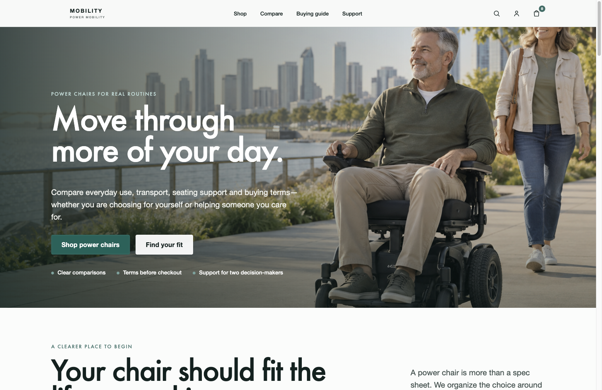
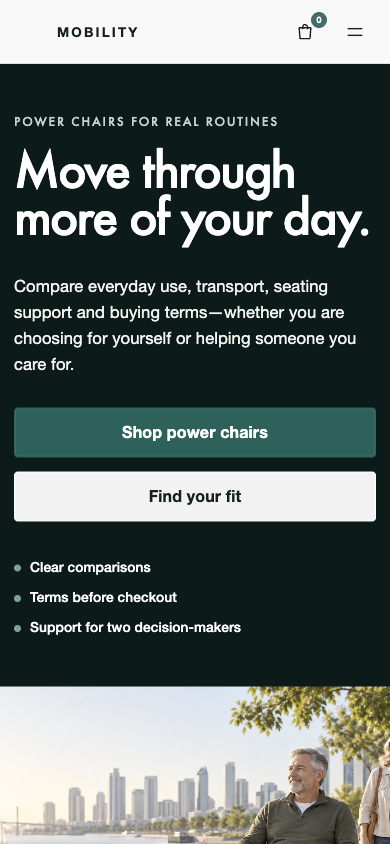
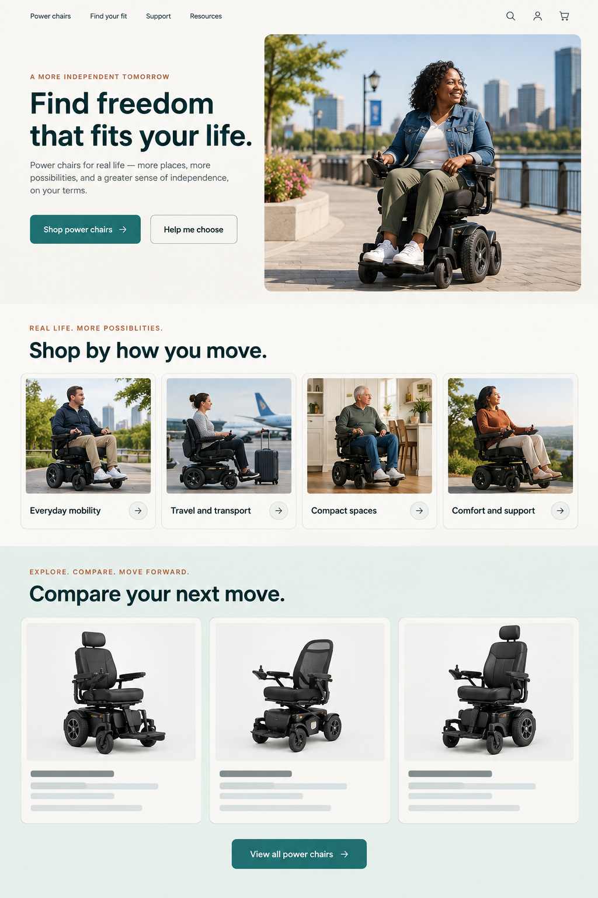
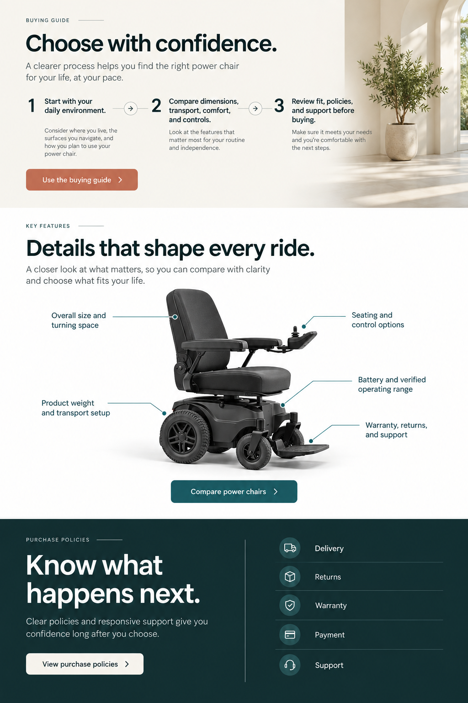
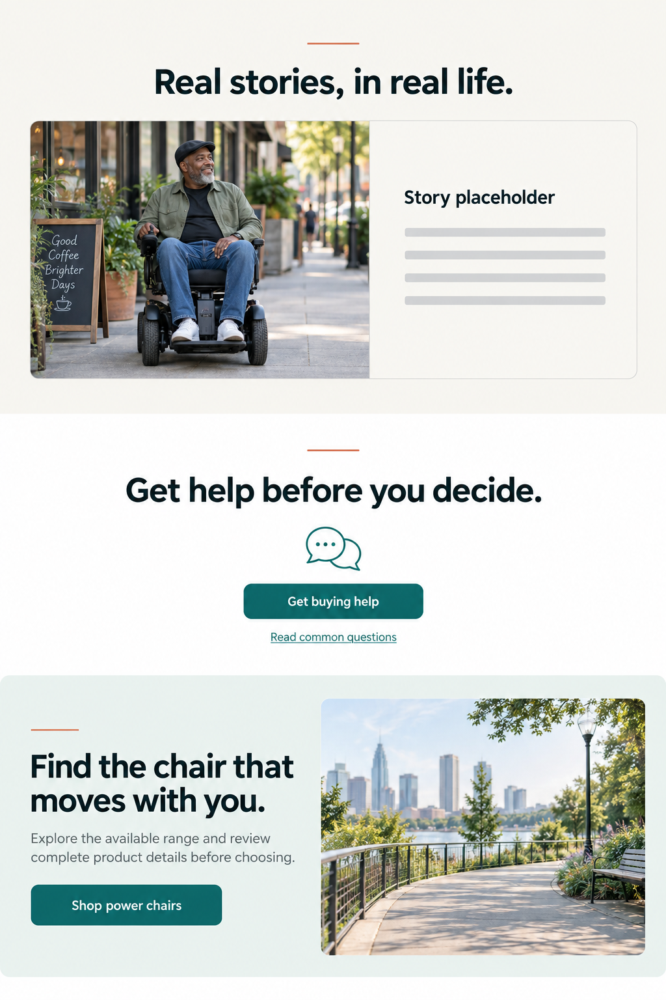
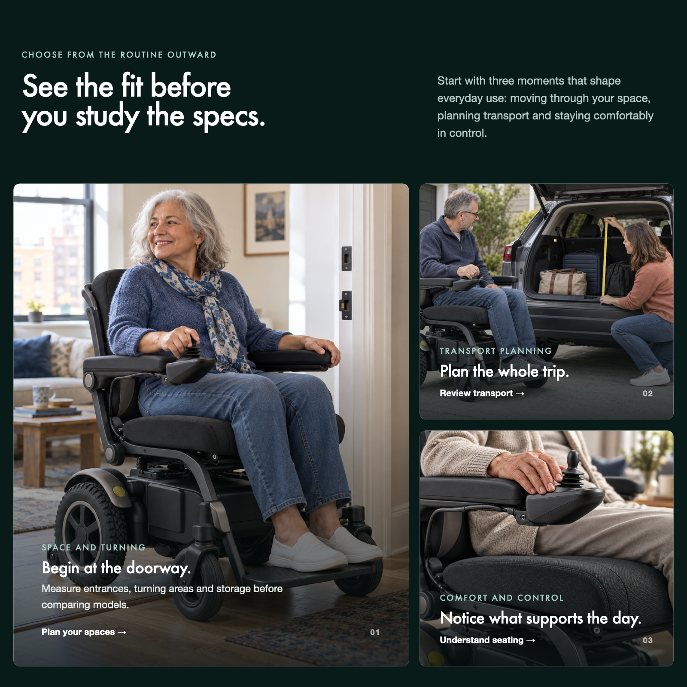
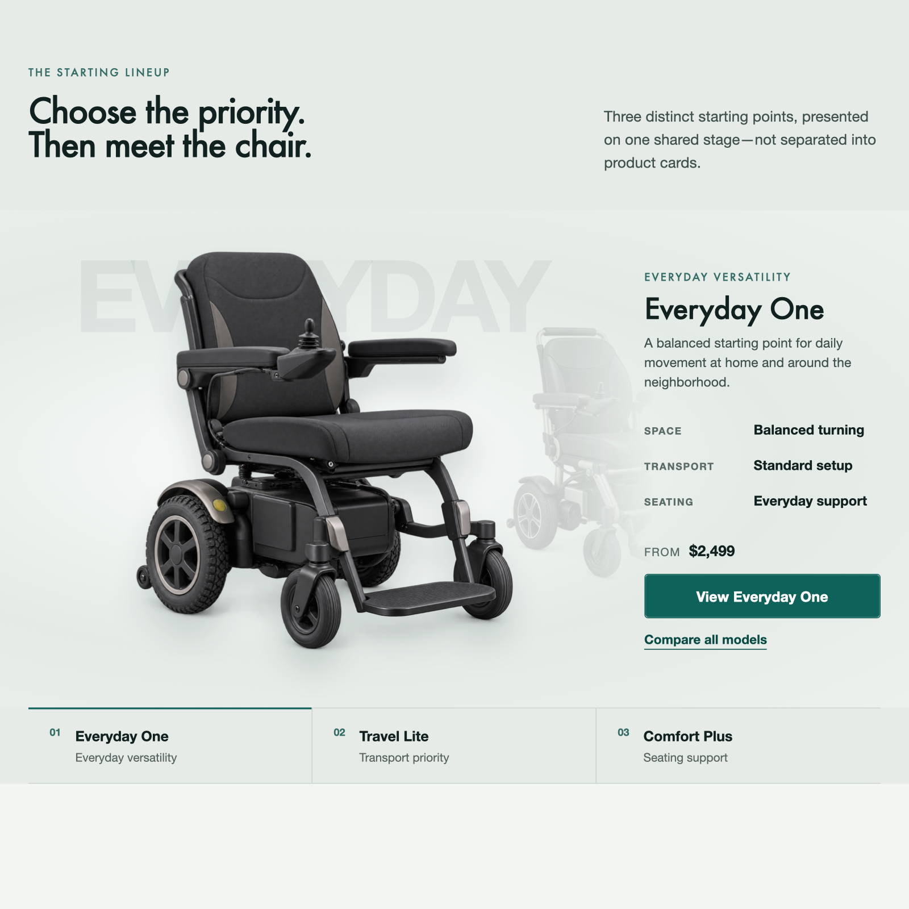
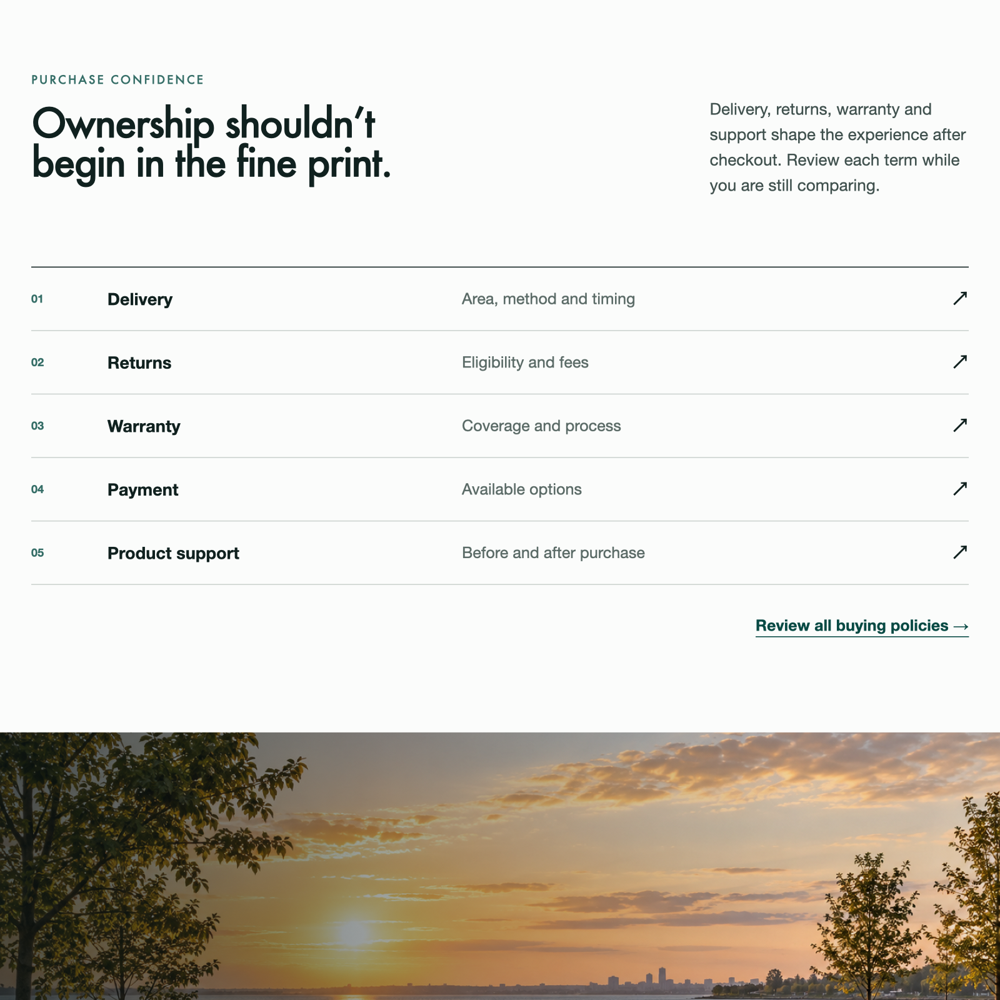

# Elementor Website Skills 实战教程：从零完成一个电动轮椅网站 HTML 设计稿

> 这是一份按真实项目整理的实战教程。我们会以一个面向美国市场的电动轮椅网站为例，从空文件夹开始，依次完成资料核实、参考研究、页面内容、视觉规范、方向稿、HTML 页面和浏览器检查。

> 本案例最终完成了 8 个相互连接的 HTML 页面和首页多轮视觉检查，尚未完成真实 Elementor Widget 开发。因此本文的主线到“确认 HTML 设计稿”为止；最后一章会说明下一步怎样进入 Widget。

## 目录

- [先说结论：你会完成什么](#先说结论你会完成什么)
- [一、这套流程适合什么项目](#一这套流程适合什么项目)
- [二、开始前要准备什么](#二开始前要准备什么)
- [三、先看完整路线](#三先看完整路线)
- [四、创建项目并让总控接手](#四创建项目并让总控接手)
- [五、核实业务资料与事实边界](#五核实业务资料与事实边界)
- [六、研究参考网站，但不要照搬](#六研究参考网站但不要照搬)
- [七、先规划页面讲什么](#七先规划页面讲什么)
- [八、建立全站视觉规范](#八建立全站视觉规范)
- [九、规划页面与模块怎样呈现](#九规划页面与模块怎样呈现)
- [十、用方向稿确认大方向](#十用方向稿确认大方向)
- [十一、把方向稿做成真实 HTML](#十一把方向稿做成真实-html)
- [十二、准备图片、文案和演示数据](#十二准备图片文案和演示数据)
- [十三、在浏览器里检查真实效果](#十三在浏览器里检查真实效果)
- [十四、怎样处理看起来怪怪的问题](#十四怎样处理看起来怪怪的问题)
- [十五、确认哪一版可以进入 Elementor](#十五确认哪一版可以进入-elementor)
- [十六、下一步怎样开发 Elementor Widget](#十六下一步怎样开发-elementor-widget)
- [十七、常见问题](#十七常见问题)
- [十八、案例文件地图](#十八案例文件地图)
- [十九、最终检查清单](#十九最终检查清单)

---

## 先说结论：你会完成什么

跟着这篇教程走完，你得到的不是一张效果图，而是一套可以继续开发的网站项目资料：

- 一份经过核实的公司、产品、用户和转化目标说明；
- 一份参考网站研究，说明值得学什么、不能复制什么；
- 每个页面的内容结构与模块顺序；
- 全站共用的颜色、字体、间距、图片和动效规则；
- 页面与模块的设计方案；
- 用于确认布局和视觉气质的方向稿；
- 可以在电脑和手机中真实打开的 HTML 页面；
- 页面检查、修改和确认记录；
- 后续 Elementor Widget 开发所需的明确依据。

这也是这套 Skills 与“一句话生成网站”的主要区别：AI 不只是把页面做出来，还要把每一步为什么这样做、哪些信息已经确认、哪些仍然未知记录下来。

下面是我刚刚从当前 `home.html` 重新截取的桌面端首屏，不是早期方向稿：



手机端会重新组织文字、按钮和图片，不是简单把桌面页面缩小：

<p align="center">
  
</p>

## 一、这套流程适合什么项目

这套流程最适合下面几类任务：

- 从零规划一个企业官网、产品站或服务站；
- 已经有 WordPress，希望使用 Elementor 搭建页面；
- 不想把一整段 HTML 直接塞进 Elementor；
- 希望先确认内容和设计，再开发可维护的自定义 Widget；
- 自己不懂完整的设计和开发流程，希望 AI 帮助补齐步骤。

本教程使用的是一个面向消费者的电动轮椅网站。它不是典型 B2B 企业站，但资料核实、参考研究、页面规划、视觉规范、方向确认和 HTML 检查的方法是共通的。

如果你做的是外贸 B2B 网站，只需要把“在线购买”相关内容替换为询盘、工程能力、交付保障、质量文件和真实案例，流程本身不需要推翻。

### 暂时不适合直接使用的项目

如果网站包含多个复杂的 CPT——CPT 是 WordPress 里的“独立内容库”，例如把产品、材料、工艺、行业和案例分别管理——并且这些内容之间还有复杂关联、筛选和查询，前期内容与设计方法仍然可以使用，但开发阶段更适合 ACF、自定义主题或更完整的 WordPress 开发方案。

## 二、开始前要准备什么

### 1. 工具

- 一个可以读取本地 Skills 和项目文件的 AI Coding 工具，例如 Codex、TRAE 或 WorkBuddy；
- 已安装到 `~/.agents/skills/elementor/` 的 Elementor Website Skills；
- 一个普通本地文件夹，用来保存项目资料和设计稿；
- 一个浏览器，用来检查最终 HTML。

只有准备进入 Widget 开发时，才需要一个已经安装 Elementor 的 WordPress 网站。前期内容规划和 HTML 设计不要求把服务器网站或主题下载到本地。

### 2. 业务资料

尽量准备下面这些内容：

- 公司或品牌介绍；
- 产品或服务说明；
- 目标国家和客户；
- 产品图片、使用场景、Logo 等素材；
- 希望访客完成的主要动作；
- 可以公开的价格、参数、政策、认证和案例；
- 暂时无法确认的内容。

资料不完整并不代表不能开始。关键是把“真实资料”“演示内容”和“暂时未知”分开，不能让 AI 把猜测写成公司事实。

### 3. 本案例的已知条件

电动轮椅案例开始时确认了：

- 行业：Power Chair，电动轮椅；
- 市场：美国；
- 类型：面向消费者的 B2C 网站；
- 主要用户：行动不便人士及其照护者；
- 主要目标：帮助用户选择产品并在线购买；
- 项目性质：设计测试，不代表真实品牌；
- 品牌名、产品名、价格、规格和政策：允许使用中性演示内容，但必须明确标记。

## 三、先看完整路线

```text
创建本地项目文件夹
→ 让总控检查当前状态
→ 核实业务资料和事实边界
→ 必要时研究参考网站
→ 规划页面内容与模块顺序
→ 建立全站视觉规范
→ 规划页面和模块怎样表达
→ 用方向稿确认布局与视觉气质
→ 制作可真实浏览的 HTML
→ 检查电脑、手机、交互和动效
→ 修正问题并确认最终 HTML
→ 再开发 Elementor Widget
```

你不需要自己记住应该先调用哪个 Skill。完整建站、恢复旧任务或不知道下一步时，始终先找：

```text
elementor-site-team-manager
```

它相当于项目经理，会判断当前缺的是资料、内容、设计、HTML 还是 Widget，然后把任务交给对应的专项 Skill。

## 四、创建项目并让总控接手

### 这一步要解决什么

建立一个独立的本地项目空间，让后续所有资料、设计决定、页面和检查结果都保存在同一个地方。

### 你要做什么

1. 创建一个空文件夹，例如：

   ```text
   powerchair-site/
   ```

2. 用 AI Coding 工具打开这个文件夹。
3. 调用 `elementor-site-team-manager`。

### 可以直接使用的开场说法

```text
使用 elementor-site-team-manager，帮助我从零规划一个面向美国市场的 B2C 电动轮椅网站。

目标用户是行动不便人士及其照护者，网站的主要目标是帮助用户选择产品并在线购买。

当前项目是设计测试，品牌名、产品名、价格和政策暂时允许使用明确标记的演示内容，不能把演示内容写成真实事实。

请先检查当前项目状态，告诉我还缺什么，不要立即生成完整页面。
```

### AI 会做什么

- 判断这是新站、延续项目还是局部修改；
- 检查目录中是否已有公司资料、内容稿和设计稿；
- 说明当前处于哪个阶段；
- 只询问会影响下一步的重要信息；
- 在跨阶段任务中维护 `docs/workflow-status.md`。

### 你要确认什么

- 项目目标是否被理解正确；
- 网站类型和目标用户是否正确；
- 主要转化目标是否正确；
- AI 有没有把未知信息说成事实；
- 下一步是否合理。

> 提醒：此时不必先创建服务器主题副本。设计阶段只需要普通项目文件夹；插件目录会在真正进入 Elementor Widget 开发时初始化。

## 五、核实业务资料与事实边界

### 这一步要解决什么

先把网站“凭什么这样说”弄清楚。否则后面的页面可能很好看，却充满未经确认的卖点、参数和承诺。

### 本案例整理了什么

案例中的公司资料被整理为：

```text
docs/company/about-company.md
```

内容包含：

- Company Basics：公司或品牌的基本情况；
- Products and Services：提供什么产品；
- Target Buyers：主要服务谁；
- Company Strengths：已知优势；
- Quality and Documentation：质量和文件证据；
- Verified Numbers：有来源的数字；
- Available Assets：可以使用的图片和素材；
- Conversion：希望访客完成什么动作；
- Missing / Pending：还缺什么；
- Restricted Claims：暂时不能说什么。

案例文件中的真实片段如下：

```md
## Company Basics

- Brand name: Pending
- Primary market: United States
- Business model: B2C power-chair website

## Conversion

- Primary conversion: Online purchase

## Restricted Claims

- Do not publish unverified safety, clinical, certification,
  warranty, customer-count or performance claims.
```

这段内容看起来很简单，却决定了后续不能随便生成认证、销量、医疗效果和保修承诺。

### 可以这样继续

```text
请先整理当前项目的业务资料和事实边界。

把已经确认、只用于演示、仍然未知和不能公开宣称的内容分开记录。缺少资料时先列缺口，不要自行补成真实事实。
```

### 你要确认什么

- 产品和服务有没有理解错；
- 用户和市场是否准确；
- 网站希望用户做什么；
- 价格、规格、政策和认证是否真的存在；
- 演示数据是否有明显说明；
- 缺失内容是否被保留下来，而不是被 AI 猜掉。

### 本案例的事实边界

轮椅网站使用了临时品牌 `MOBILITY`，以及 `Everyday One`、`Travel Lite`、`Comfort Plus` 三款演示产品。这些名称、价格和政策只用于验证页面设计和选购流程，不能直接用于真实网站上线。

## 六、研究参考网站，但不要照搬

### 这一步要解决什么

参考研究不是找一张“喜欢的网页”让 AI 模仿，而是回答：

- 目标用户已经习惯什么；
- 同行业网站常见什么问题；
- 哪些表达方法适合当前任务；
- 哪些品牌语言、布局和素材不能复制。

### 本案例怎样做

项目研究了 WHILL、Permobil、Pride Mobility、Elevate Mobility、Power Mobility 等同行网站，后来又针对页面“像画册、太平面”的问题，研究了电动自行车品牌 Aventon。

Aventon 不是轮椅同行。之所以仍然有参考价值，是因为它解决了相似的问题：怎样让复杂产品成为页面主角，怎样用不同尺度的媒体和内容节奏建立品牌体验，怎样让购买入口与产品展示结合。

研究结果保存为：

```text
docs/research/home-aventon-visual-reference-brief.md
```

研究文件不是简单记录“喜欢 Aventon 的风格”，而是明确写出观察、可迁移方法和不能照搬的内容：

```md
## Adoptable Principles

- Put controls where the changing object is.
- Make each long scroll earn a new type of evidence.
- Use media as surface and proof, not as decoration inside a card.
- Keep motion task-led.

## Do Not Copy

- Aventon logos, typography, campaign copy, product photography,
  videos, slide compositions and adventure positioning.
```

### 可以这样发起研究

```text
请研究 3–5 个值得参考的网站。

先说明每个网站为什么值得看，再区分：
1. 用户已经期待的行业基础做法；
2. 容易产生模板感的常见套路；
3. 可以迁移到本项目的表达方法；
4. 不能复制的品牌、内容和素材。

研究结果要能交给后续内容规划和页面设计使用，不要只写审美评价。
```

### 你要确认什么

- 参考网站是否与当前用户任务有关；
- 学到的是方法，还是只因为“看起来高级”；
- 有没有误把静态截图推断成复杂交互；
- 有没有复制对方品牌语言和业务事实；
- 研究结论能否转成具体的页面建议。

### 案例里的重要教训

项目最初主要用背景色和卡片区分模块，页面像几张画册纵向拼在一起。Aventon 带来的有效启发并不是“多加视频和滚动动画”，而是：

- 让产品成为视觉主角；
- 改变不同模块的观看方式；
- 用图片尺度、留白和明暗建立层次；
- 把切换控件放在被操作对象附近；
- 只有内容和素材支持时，才使用较强的滚动叙事。

## 七、先规划页面讲什么

### 这一步要解决什么

在讨论颜色和布局之前，先回答：页面给谁看、要解决什么问题、先讲什么、拿什么证明、希望用户下一步做什么。

### 本案例的首页结构

经过多轮整理，首页内容被收敛为七个核心部分：

1. 首屏：让用户快速知道这是什么产品，并进入购买；
2. 使用需求：按空间、出行、舒适等真实需求浏览；
3. 产品选择：展示不同定位的产品；
4. 使用情境与选购：帮助用户判断适合自己的方向；
5. 购买政策：配送、退换、保修与付款；
6. 购买帮助：降低选择和售后顾虑；
7. 最终入口：继续选购或比较产品。

内容规划保存在：

```text
docs/page-content/home.md
```

其中一个模块会被写成下面这样，而不是只留下“这里做一个商品区”：

```md
### S3 · home-featured-products / 商品选择

- 模块任务：展示可购买商品的价格、定位和统一比较字段。
- Product 1: Everyday One / Everyday versatility / Demo price $2,499
- Product 2: Travel Lite / Transport priority / Demo price $2,199
- Product 3: Comfort Plus / Seating support / Demo price $3,299
- Shared fields: Space & turning / Transport setup / Seating support
- Actions: Compare / View details
```

这类内容可以直接交给页面设计和 HTML，不需要后续设计阶段重新猜测商品区应该放什么。

### 可以这样发起内容规划

```text
请根据已经确认的公司资料、用户和转化目标，规划首页内容。

先说明用户进入页面时最关心的问题，再安排模块顺序。每个模块需要写清：
- 模块要解决什么问题；
- 主要内容；
- 可以使用的真实证据；
- 主要行动入口；
- 仍然缺少的资料。

不要先决定所有模块都使用三列卡片，也不要为了填满页面编造客户故事、参数或认证。
```

### 你要确认什么

- 模块顺序是否符合用户的决策过程；
- 相邻模块是否在重复同一件事；
- 文案是否具体，而不是反复使用“自由、信心、专业”；
- 购买或询盘条件有没有说清楚；
- 有没有用未经确认的图片或故事证明产品能力；
- 页面是否长得没有必要。

### 不要把内容规划做成固定模板

轮椅首页最后采用七个模块，是这个项目的选择，不代表每个网站都必须是七个模块。一个 B2B 服务页可能更需要问题、能力、流程、质量证据和询盘入口；产品页也可能需要规格、适用边界和下载文件。

## 八、建立全站视觉规范

### 这一步要解决什么

设计系统就是一套全站共用的视觉规则。它用来回答：

- 什么颜色分别承担背景、文字、行动和提示；
- 标题、正文和数字应该怎样区分；
- 页面宽度、间距和留白怎样统一；
- 按钮、卡片、表单和选择状态长什么样；
- 图片应该使用什么比例和裁切方式；
- 动效应该是什么性格和强度。

### 本案例的视觉方向

轮椅网站采用 `Premium Human Mobility`，可以理解为“有品质但不冰冷的人本出行”。它不是简单写几个形容词，而是把产品和用户特征转成具体规则：

- 大面积暖白和中性灰，保持清楚、稳定；
- 深墨色负责结构与文字层级；
- 青绿色只用于购买动作和选中状态；
- 少量陶土或琥珀作为编辑提示；
- 图片关注真实生活、空间、运输和操作细节；
- 动效保持克制，重点是切换反馈和信息变化。

设计规则保存在：

```text
docs/design-system/design-system.md
设计稿/design-system/style-board.html
```

设计系统中的规则会说明用途和边界，而不是只给一组色值：

```md
| Role | Value | Use | Boundary |
| --- | --- | --- | --- |
| Action Teal | #176A6B | 购买按钮、选中状态、重要链接 | 不作为整段背景 |
| Evergreen Ink | #172426 | 标题和最高层级文字 | 不让所有表面都变暗 |
| Warm Canvas | #F4F1EB | 页面主背景 | 不在每个模块后重复铺设 |
| Human Clay | #B85F49 | 少量编辑强调 | 不承担购买 CTA |
```

### 可以这样发起设计系统

```text
请根据已确认的产品、用户、参考研究和内容规划，建立全站 Design System。

不要只给颜色和字体列表。请说明这些选择为什么属于当前产品和用户，并明确颜色、字体、圆角、阴影、图片与动效各自的使用边界。

先生成样式板让我确认，不要立即制作完整页面。
```

### 你要确认什么

- 视觉方向是否符合产品和用户，而不是套用流行风格；
- 强调色有没有被到处使用；
- 标题和正文是否容易阅读；
- 圆角、阴影和卡片是否过量；
- 图片色调是否与页面叠加后产生偏色；
- Hover、Focus、Selected、Disabled 等状态是否齐全；
- 动效是否有统一性格，而不是每个模块自行发挥。

### 案例里的重要教训

早期样式板单独看没有大问题，但整页加入绿色服装、植物和相似图片后，页面明显偏绿。这说明：样式板只能验证基础规则，最终仍要把真实图片放进整页检查。

## 九、规划页面与模块怎样呈现

### 这一步要解决什么

内容规划解决“讲什么”，UI Architecture——也就是页面和模块的设计方案——解决“怎样呈现”。

这一步会决定：

- 首屏采用什么结构；
- 每个模块怎样组织图片、文字和按钮；
- 模块之间怎样形成连续节奏；
- 哪些交互真的有必要；
- 手机端怎样重新组织内容；
- 哪些设计会成为页面记忆点。

### 本案例的两个层级

全站方案：

```text
设计稿/directions/site/site-ui-architecture-map.md
```

首页详细方案：

```text
设计稿/directions/home/home-ui-architecture-map.md
```

全站方案的部分内容如下：

```md
## Full-site visual narrative

The site moves from lived context to product understanding,
then to comparable facts and buying terms.

Premium quality comes from media scale, product detail,
changing composition and controlled motion—not from assigning
a different background color to every module.
```

它把“不要像画册”转成了可以执行的设计要求：改变图片尺度、模块构图和内容密度，而不是继续给每个区块换背景色。

### 可以这样继续

```text
请根据已确认的首页内容和 Design System，规划首页 UI Architecture。

每个模块要写清：
- 主要任务；
- 桌面布局；
- 手机布局；
- 图片承担什么作用；
- 按钮和交互位置；
- 是否需要动效，以及动效帮助用户理解什么。

不要默认所有模块都是左文右图或三列卡片。首页要有一条从首屏延续到页面结尾的视觉主线。
```

### 你要确认什么

- 每个模块是否解决对应的内容任务；
- 页面是不是从头到尾都在重复同一种卡片；
- 图片、标题、价格和按钮能不能一起理解；
- 交互控件是否靠近被操作对象；
- 手机端是否仍然清楚；
- 动效有没有目的；
- 是否出现“首屏有特色，后面全部退回模板”的情况。

## 十、用方向稿确认大方向

### 方向稿是什么

方向稿是一张或几张用于确认页面视觉方向的图片。它主要帮助你判断：

- 布局和模块关系；
- 页面主次；
- 图片与文字的关系；
- 整体色彩和视觉气质；
- 页面是不是你想要的方向。

方向稿不是可以逐像素还原的最终设计稿。换行、精确间距、图片真实裁切、按钮状态和交互手感，要在 HTML 阶段继续完成。

### 本案例怎样使用方向稿

首页方向被拆成三个连续片段：

```text
设计稿/directions/home/home-direction-segment-01.png
设计稿/directions/home/home-direction-segment-02.png
设计稿/directions/home/home-direction-segment-03.png
```

下面是项目实际生成的三个方向稿片段。它们记录了当时确认的布局和视觉方向，但并不等于当前 HTML 的最终细节：

<table>
  <tr>
    <td width="33%"></td>
    <td width="33%"></td>
    <td width="33%"></td>
  </tr>
</table>

分段的好处是可以看清细节，又不会因为一张超长图而看不清内容。最终仍需要合起来判断整页节奏。

### 你应该怎样反馈

好的反馈：

```text
保留首屏的产品尺度和文字位置。
商品区看起来仍像三张普通卡片，希望产品成为一个连续展厅。
购买保障区黑色面积太重，想要更轻、更开放的结构。
方向稿只作为布局参考，HTML 阶段可以批判性优化。
```

不够清楚的反馈：

```text
不好看。
再高级一点。
感觉不太对。
```

如果你只能感觉“怪怪的”，却说不清原因，可以让总控调用一个没有参与制作的子 Agent。你可以把它理解为一位独立 AI 审查员：它会重新看方向稿，指出可能的问题，但最终是否修改仍由你决定。

### 方向稿进入 HTML 前检查什么

- 页面结构与内容规划是否一致；
- 重要内容和行动入口是否明显；
- 风格是否符合已经确认的设计系统；
- 有没有明显模板感或信息重复；
- 有没有不适合机械照搬的构图；
- 关键模块是否已经获得你的确认。

## 十一、把方向稿做成真实 HTML

### 两种进入方式

#### 做一个完整新页面

方向稿确认后，先生成整页 HTML，再从上到下精细调整每个模块。

适合：首页、完整产品页、服务页和其他新页面。

#### 只做一个模块

如果只是新增或重做某个模块，可以直接制作单模块 HTML，不需要重做整页。

适合：Banner、流程、FAQ、优势、案例或产品展示模块。

轮椅案例属于第一种：先完成整页，再重点打磨商品展厅、购买保障、Header、Hero 和场景内容。

下面这些不是重新生成的效果图，而是从项目中已经生成的 HTML 模块预览重新截图得到的真实页面状态。

### 使用环境模块

图片分别承担空间、运输和操控细节说明，而不是三张没有任务的装饰图。



### 商品展厅模块

三款产品共享一个舞台。当前产品、名称、差异字段、价格和按钮可以在同一视区内理解，不再是三个普通商品卡片。



### 购买政策模块

配送、退换、保修、付款和支持使用开放式条目组织，没有为了“高级感”再套一层黑色卡片。



### 可以这样发起 HTML 制作

```text
请以已经确认的首页内容、Design System、UI Architecture 和方向稿为依据，制作完整首页 HTML。

方向稿只锁定布局、模块关系和整体气质。请在真实浏览器中主动完善换行、间距、图片裁切、响应式和交互，不要机械逐像素照搬方向稿。

先完成桌面和手机可用版本，再汇报检查结果。未经确认不要进入 Elementor Widget。
```

### HTML 阶段允许优化什么

- 精确字号和行高；
- 文字换行；
- 模块间距；
- 图片裁切和焦点位置；
- 电脑与手机布局；
- Hover、Focus、Selected 等状态；
- 已确认交互的实现方式；
- 已确认动效的时间、位移和降级方式。

### HTML 阶段不能擅自改变什么

- 已确认的业务事实；
- 页面目标和主要模块任务；
- 已确认的视觉主线；
- 重要 CTA 的业务含义；
- 设计系统中的全站权威规则；
- 用户明确锁定的构图和内容。

如果实现时发现方向稿本身存在设计问题，应说明原因并返回 UI 方案修正，而不是在 CSS 中悄悄做成另一套设计。

## 十二、准备图片、文案和演示数据

### 先定义图片任务，再找图

不要只告诉 AI“这里放一张高级图片”。应该先说明图片让用户看什么：

- 首屏场景图：建立产品与真实生活的关系；
- 产品透明图：识别型号和结构；
- 运输图：说明产品怎样进入车辆；
- 室内图：说明在紧凑空间中的使用；
- 细节图：展示座椅、控制器或轮组；
- 政策或支持模块：通常不需要伪造人物故事。

### 什么时候可以使用生成图

生成图可以用于：

- 验证构图和配色；
- 验证页面需要什么比例的素材；
- 在设计测试中代替暂时缺少的生活场景。

生成图不能用来证明：

- 产品真实外观和结构；
- 续航、承重、折叠和适航能力；
- 工厂、证书、客户和真实案例；
- 配送、保修和售后承诺。

### 文案与页面的关系

设计稿应该使用接近真实长度的文案。只有 `Title`、`Description` 这样的占位词，会让布局检查失去意义。

但页面实现也不能为了填满版面临时编造内容。正确做法是：

1. 从已经确认的内容规划中取文案；
2. 未确认字段使用明确标记的演示内容；
3. 真实上线前逐项替换并再次检查布局。

## 十三、在浏览器里检查真实效果

### 为什么效果图还不够

方向稿无法证明下面这些事情：

- 标题在真实字体中怎样换行；
- 图片是否被错误裁切；
- 手机端有没有横向溢出；
- 商品切换后价格和链接是否同步；
- 键盘能否操作；
- 动画快速重复时会不会卡住；
- Header 滚动后是否仍然可读。

因此，HTML 完成后必须在真实浏览器检查。

### 本案例检查了什么

- 1512px、1024px 和 390px 等代表性宽度；
- 图片是否全部加载；
- 页面是否出现横向溢出；
- Header、Hero 和手机菜单；
- 三款产品的名称、价格、详情链接和选中状态；
- 点击、键盘和手机滑动；
- 减少动态效果时能否正常阅读；
- 页面中是否残留 Prototype、Placeholder 或内部设计说明。

手机端也需要单独看真实页面状态，不能用桌面截图代替。本文开头的手机首屏就是从当前 `home.html` 单独切换到 390px 视口后重新截取的结果。

### 可以这样要求检查

```text
请对当前首页完成浏览器检查。

至少检查桌面、平板和手机，重点确认：
- 图片加载和裁切；
- 标题与正文可读性；
- Header 与 Hero 的关系；
- 横向溢出；
- 所有商品切换状态；
- 键盘和触控操作；
- 动效关闭后的可用性；
- 页面是否残留演示说明或内部设计语言。

请分开说明：已经实现、已经验证、仍未验证、需要我确认。
```

### 独立 HTML 评审

每个真正发生设计的新页面，在浏览器自查后，可以由一个没有参与制作的子 Agent 进行一次独立检查。它重点看：

- 用户能不能快速看懂页面；
- 内容和行动入口是否清楚；
- 页面有没有明显模板感；
- 品牌、图片和排版是否统一；
- 手机端是否成立；
- 交互与动效是否自然。

如果页面包含 Tabs、Carousel、Viewer 等主要交互，还可以增加一次开放式操作走查：只给评审者页面入口，不告诉它预期怎么操作，看它能否自然完成主要任务。

独立评审发现的问题不能直接照单全改。主 Agent 需要先复现问题，再判断应该回到内容、设计系统、页面设计还是 HTML 实现。

## 十四、怎样处理看起来怪怪的问题

轮椅项目最有价值的部分，不只是最终页面，而是多次修改暴露出的判断方法。

### 问题 1：页面像画册

**表现：** 每一段都是标题、说明、卡片和背景色，看起来像几张海报上下拼接。

**错误做法：** 继续换颜色、加阴影、给每段增加淡入动画。

**正确处理：** 回到 UI Architecture，检查媒体尺度、模块观看方式、产品角色和整页节奏。这个项目后来引入沉浸首屏、连续商品展厅、横向场景和开放式购买保障，而不是继续增加卡片。

### 问题 2：Header 与 Hero 重叠

**表现：** 透明 Header 压在首屏图片上，文字反差不稳定。

**正确处理：** 重新明确 Header 与 Hero 的关系。案例最终采用独立实体 Header，让 Hero 图片从 Header 下方开始。

这不是单纯改一个颜色，而是共享导航与页面首屏之间的设计关系发生改变。

### 问题 3：商品切换控件离产品太远

**表现：** 用户需要滚到模块底部才能切换产品。

**正确处理：** 把上一款、下一款和当前型号放回产品舞台附近，让操作入口靠近被操作对象。

### 问题 4：解决重叠后，信息反而看不全

项目曾为了避免产品图片与规格线重叠，把图片和商品信息拆成上下两段。虽然重叠消失了，但用户无法在一屏内同时看到产品、价格和购买按钮。

最终桌面端改为左图右文，让产品、名称、差异、价格和按钮处于同一个决策视区。

这说明每次修改后不能只检查“原问题消失没有”，还要检查有没有产生第二个问题。

### 问题 5：页面整体偏绿

问题不仅来自按钮颜色，还来自绿色服装、植物、图片环境和连续背景。正确做法是把图片一起纳入整页配色检查，而不是只修改一个色值。

### 问题 6：长滚动没有带来新信息

案例曾用同一张商品图支撑很长的滚动故事，结果看起来只是被动画拉长。

正确判断是：

- 每一步都有不同内容和素材，滚动叙事才可能成立；
- 如果没有新信息，优先缩短模块；
- 动效不是页面完成条件。

### 有明确修改方向时，不必再找子 Agent

例如你已经明确说：

- Header 不要压在 Hero 上；
- 商品区改成左图右文；
- 按钮增加约 10px 圆角。

这时应直接修改并定向复查。

只有你能指出“不舒服”，却不知道问题和方向时，再让独立子 Agent 帮助诊断，避免为了评审而增加流程。

## 十五、确认哪一版可以进入 Elementor

在开始 Widget 开发前，先明确一份 Canonical HTML——也就是“后续开发唯一采用的确认版 HTML”。

至少确认下面这些内容：

- 页面内容和模块顺序已经确认；
- 全站视觉规则没有明显冲突；
- 方向稿问题已经复核；
- HTML 在电脑和手机上检查过；
- 主要交互状态可以使用；
- 严重问题已经解决；
- 演示内容和真实资料已经区分；
- 明确哪些内容需要在 Elementor 后台编辑；
- 明确下一次只开发哪个 Widget。

可以这样确认：

```text
我确认当前 home.html 作为后续 Elementor 开发的唯一设计依据。

下一步先选择一个边界清楚、能够独立复用的模块，确认后台需要开放的字段，再开发单个 Widget。不要一次批量生成全部组件。
```

## 十六、下一步怎样开发 Elementor Widget

本案例目前还没有走完这一阶段，因此下面是标准后续路径，不是轮椅项目已经完成的结果。

### 1. 初始化插件目录

进入第一个 Widget 前，`elementor-site-initialize` 会让你确认：

- 插件名称和目录；
- Elementor 组件分类名称；
- 预计组件数量；
- 使用简单平铺结构，还是按业务分组；
- 本地插件保存在哪里。

插件可以放在普通本地项目文件夹中，不要求你先下载服务器主题。

### 2. 一次开发一个 Widget

每个 Widget 先确认：

- 对应哪个 HTML 模块；
- 哪些文字、图片和列表需要后台编辑；
- 哪些视觉规则应该继承全站设置；
- 哪些结构和动效不应该随意开放；
- 是否存在多个实例同时使用的情况。

### 3. 在真实 Elementor 验收

Widget 完成后，还要在真实 WordPress + Elementor 中检查：

- 编辑器中能否找到；
- 内容字段是否够用；
- 桌面和手机效果是否与确认 HTML 一致；
- 字体、颜色和图片裁切有没有退化；
- 多个实例是否互相影响；
- 编辑器重新渲染后交互是否仍然正常。

### 4. 安装和更新插件

把本地完整插件目录压缩成 ZIP，通过 WordPress 后台上传；或者复制到：

```text
wp-content/plugins/
```

以后新增 Widget 时，继续更新本地同一个插件目录，再提高版本号、完整打包并替换旧版本。正式站更新前，先备份或在测试站验证。

## 十七、常见问题

### 1. 我已经有网站，只想重做一个模块，还要从头开始吗？

不用。告诉总控这是局部设计或局部精修，并说明哪些内容和视觉规则已经确认。它应该直接进入受影响的模块，不重做整站资料。

### 2. 我已经有文案，还需要内容规划吗？

需要检查，但不一定重写。重点判断文案是否回答用户问题、模块是否重复、证据是否真实，以及现有长度能否支持设计。

### 3. 方向稿不好看，应该继续生成更多图吗？

先判断问题来自内容、全站视觉规则还是模块构图。没有找到原因前连续生图，通常只会得到不同版本的同一种问题。

### 4. HTML 与方向稿不完全一样，是不是还原失败？

不一定。方向稿只确认大方向，HTML 应该批判性完成真实排版和交互。但如果页面概念、模块任务和主要构图被擅自改变，就需要说明原因并重新确认。

### 5. 每个页面都必须使用子 Agent 吗？

真正发生设计的新页面应认真检查；明确的小改、内容替换和普通 Bug 修复不需要增加独立评审。你已经有明确修改方向时直接改；只有方向不确定时再申请辅助诊断。

### 6. 可以一次生成所有 Widget 吗？

不建议。先选择一个代表性模块，验证字段、样式继承、资源加载和 Elementor 生命周期。第一项稳定后，再沿用同一规则继续。

### 7. 为什么不直接在 Elementor 里边做边看？

HTML 阶段更适合快速确认整页结构、响应式和交互。如果直接进入 Elementor，内容问题、设计问题和插件问题容易混在一起，返工更慢。

### 8. 这套方法只能用于 Elementor 吗？

不是。资料核实、参考研究、内容规划、设计系统、UI 方案和 HTML 检查都可以迁移到 ACF、Gutenberg、Next.js、Astro、React 或其他 CMS。Elementor 只是这套仓库最终采用的一种实现方式。

## 十八、案例文件地图

轮椅案例最终留下了下面这些主要文件：

```text
docs/
├── company/
│   └── about-company.md
├── research/
│   └── home-aventon-visual-reference-brief.md
├── page-content/
│   └── home.md
├── design-system/
│   └── design-system.md
├── retrospectives/
│   └── powerchair-test-site-skill-retrospective.md
└── workflow-status.md

设计稿/
├── design-system/
│   └── style-board.html
├── directions/
│   ├── site/
│   │   └── site-ui-architecture-map.md
│   └── home/
│       ├── home-ui-architecture-map.md
│       ├── home-direction-segment-01.png
│       ├── home-direction-segment-02.png
│       └── home-direction-segment-03.png
├── pages/
│   ├── home.html
│   ├── power-chairs.html
│   ├── product.html
│   ├── compare.html
│   ├── buying-guide.html
│   ├── buying-policies.html
│   ├── support.html
│   └── about.html
└── assets/
    ├── css/
    ├── js/
    └── images/
```

### 这些文件分别有什么用

| 文件 | 用途 |
| --- | --- |
| `about-company.md` | 保存已确认事实、缺口和不能宣称的内容 |
| `visual-reference-brief.md` | 把参考网站转成可执行方法 |
| `page-content/home.md` | 确认首页讲什么、按什么顺序讲 |
| `design-system.md` | 保存全站共用的视觉规则 |
| `style-board.html` | 在真实浏览器中预览基础视觉语言 |
| `site-ui-architecture-map.md` | 规划整站页面家族与视觉节奏 |
| `home-ui-architecture-map.md` | 规划首页每个模块怎样呈现 |
| `home-direction-segment-*.png` | 确认布局、主次和视觉气质 |
| `home.html` | 进入浏览器检查的真实页面 |
| `workflow-status.md` | 记录当前阶段、已确认内容和下一步 |
| `retrospective.md` | 记录返工原因和可复用经验 |

## 十九、最终检查清单

### 业务与内容

- [ ] 已确认网站给谁看、希望用户做什么；
- [ ] 真实资料、演示内容和未知内容已经分开；
- [ ] 页面模块顺序符合用户决策过程；
- [ ] 没有虚构公司能力、案例、认证、价格或政策；
- [ ] 主要 CTA 与页面目标一致。

### 视觉与方向稿

- [ ] 全站颜色、字体、间距和图片规则已确认；
- [ ] 重要页面有明确视觉主线；
- [ ] 没有让所有模块都退回同一种卡片；
- [ ] 方向稿只作为方向，不被机械照搬；
- [ ] 关键方向问题已完成独立复核或明确自查。

### HTML

- [ ] 电脑、平板和手机均无横向溢出；
- [ ] 图片全部正常加载并正确裁切；
- [ ] 标题、正文、按钮和价格容易阅读；
- [ ] Header、Footer、菜单和主要链接正常；
- [ ] 所有切换状态都检查过；
- [ ] 键盘和触控可以完成主要操作；
- [ ] 减少动态效果后内容仍然完整；
- [ ] 页面没有残留内部设计说明和占位词；
- [ ] 独立评审发现的严重问题已经处理。

### 进入 Elementor 前

- [ ] 已明确唯一确认版 HTML；
- [ ] 已确认第一个要开发的 Widget；
- [ ] 已确认后台真正需要开放的字段；
- [ ] 不会一次批量生成全部 Widget；
- [ ] 最终仍会在真实 Elementor 中重新验收。

---

## 写在最后

这个电动轮椅项目并不是一次就完成的。它经历过页面偏绿、模块像画册、商品区卡片感太强、Header 与 Hero 关系不清、切换控件太远，以及“修掉一个问题又带来第二个问题”等情况。

这些返工并不意味着流程没有价值。相反，它们帮助我们看清：AI 可以非常快地生成页面，但如果没有事实边界、内容职责、视觉规则、独立检查和浏览器验证，错误也会被非常快地放大。

真正可靠的使用方式不是期待 AI 第一次就给出完美网站，而是让每个阶段都留下可以检查的结果：

```text
事实可以核对
内容可以确认
设计可以讨论
页面可以操作
问题可以返回正确环节修正
```

当这些环节被串起来，AI 才不只是“帮你画网页”，而是在帮助你建立一套可以继续复用的网站生产流程。
